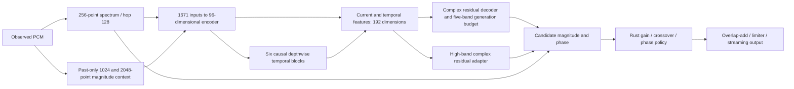

# Current architecture, external methods and evaluation boundaries

Date: 2026-10-26. This review accompanies the
[P61 critic objective audit](critic-objectives-p61.md). Its purpose is to choose
the next falsifiable experiment, not declare a universally optimal architecture.

## What is actually running

The recent P54-P57 restoration checkpoints instantiate `TrainableAdapter`, a
`SpectralAdapter` over `RestorationHead`, with width 96, complex output,
residual generation budget, input-relative coordinates and high-band adapter
support. The P60 registration binds the exact two P57 generator checkpoints;
loading them gives **480,809 parameters** and **6,048 float state values** per
physical channel. `SoundExGenerator` in `models/generator.py` is a different,
older dual-stream encoder-decoder; its name does not identify the recent model.
The P59/P60 critics are training-only and are not the restoration network.

- The learned encoder sees 129 short-window magnitudes, 1,538 long-window
  magnitudes, log RMS and three physical/detector conditions. Long-window features
  update every four hops and are held between updates. They use past samples;
  their duration is not extra output lookahead.
- LayerNorm/GELU follow the 1,671-to-96 dense projection. Six residual temporal
  blocks use depthwise kernel size 2, dilations 1/2/4/8/16/32 and pointwise
  96-to-192-to-96 transformations. Their receptive field spans 64 feature steps;
  long-window input support must be accounted for separately.
- The current and temporal embeddings concatenate into 192 dimensions. The
  decoder is 192-to-96-to-258; the additional adapter is 192-to-258. Both supply
  real/imaginary residual coordinates for 129 frequency bins. A five-output
  budget head controls smooth frequency-dependent generation units. The adapter
  has an independent input-scaled residual, ramping from 4 to 8 kHz.
- The backbone currently uses magnitude information; observed phase supplies the
  residual coordinate frame and final phase reconstruction, rather than a learned
  phase encoder. Explicit phase inputs were tested earlier in P28/P31 without a
  qualified win; their failure is not proof that phase modeling cannot help.
- P57 full training updates the whole existing model. P54 adapter-only training
  updates 49,794 parameters. P59/P60 change neither generator nor DSP weights.

The dense encoder can mix all frequencies, so it is incorrect to say it lacks
cross-band communication. Its compression into a single vector and absence of
explicit frequency-local tokens are plausible inductive-bias limitations, not
proven causes. The waveform is never a teacher generated by protective DSP:
current common training uses direct original spectra and raw overlap-add MR
spectra, with complex/energy/time fidelity and clean identity constraints.

P57 measured a 2.238792 ms maximum frontend/model/DSP compute over 52,000 hops,
with no compute service overrun but one paced completion 0.468495 ms late.
The fixed 256-frame buffer is 5.333 ms at 48 kHz, separately from compute.
These historical measurements describe that graph, not a future architecture or
device qualification. See [P57](joint-training-p57.md) for the retained failures.

## What external implementations contribute

| Primary source | Relevant idea | Limit for SoundEx |
| --- | --- | --- |
| [Apollo paper](https://arxiv.org/html/2409.08514v1), [pinned implementation](https://github.com/JusperLee/Apollo/blob/e84bcacc59d5455f05d86a5c97dd4aeb3c14dbb6/look2hear/models/apollo.py) | Compressed-music restoration with band-wise features, frequency communication, temporal processing and complex reconstruction. | The inspected code uses 80 bands, frequency Roformer and temporal blocks. Its default 20 ms STFT and symmetric temporal convolution are not the current causal hop contract. Frequency-axis attention itself is not future time access. Borrow the decomposition, not claimed CPU latency or its weights. |
| [AP-BWE official implementation](https://github.com/yxlu-0102/AP-BWE) | Interacting amplitude/phase streams and multiple waveform/spectral discriminators. | Speech bandwidth extension is not mixed-music codec repair. Its adversarial-plus-feature training is different from our frozen-generator, tiny magnitude-only critic experiment. P60 does not disprove AP-BWE or all GAN supervision. |
| [Vocos BWE, March 2026](https://arxiv.org/html/2603.07285v1) | Fourier synthesis, ConvNeXt blocks and smooth low/high-band refinement. | The paper evaluates VCTK speech using 2048-point analysis and hop 512, with a width-512, eight-block backbone. Reported CPU/GPU RTF is throughput, not 128-hop latency. No matched music-restoration or device guarantee follows. |
| [Original Vocos code](https://github.com/gemelo-ai/vocos/blob/eb39abfc42c1dee4854d9b10d44dd7d4fd3b0e53/vocos/models.py) | Efficient frame-level processing and Fourier-domain synthesis. | The inspected embedding and ConvNeXt temporal kernels use symmetric padding. This is the original vocoder implementation, not verified source for the 2026 BWE extension. It needs causal/state adaptation before our deployment. |
| [DeepFilterNet](https://arxiv.org/abs/2305.08227), [previous source audit](implementation-review-20261026.md) | Efficient speech enhancement with band envelopes and complex multi-frame filtering. | Useful state/DSP engineering; filtering alone cannot generate from exactly absent input bins. Its task and lookahead settings need separate review. |
| [Music latent-geometry study, August 2026](https://arxiv.org/html/2608.03721v1) | Compare a simple latent mean shift against learned restoration; isolate encoder/decoder contributions. | It uses ideal band-limited music and pretrained neural codecs. The codec roundtrip, latency, license and synthesis error are part of the system. A simple latent operation does not make the complete system cheap or qualified for MP3/AAC/Vorbis. |

Newly inspected Vocos source is pinned at
`eb39abfc42c1dee4854d9b10d44dd7d4fd3b0e53`; three source files, its license and
the two 2026 papers are archived with URL/SHA-256 under
`data/research/architecture-review-p61-20261026/`. Earlier Apollo/AP-BWE/DeepFilterNet
source pins remain in the [implementation review](implementation-review-20261026.md).
No external code, checkpoints or audio are incorporated. Source-license review
does not establish rights to another project's trained weights or datasets.

## Evaluation corrections and fixed acceptance layers

P59/P60 classification prerequisites are valid tests of their declared classifier
mechanism. They are **not** a necessary theorem about paired feature loss and
are not restoration acceptance tests. Keep those failed results intact, but do
not infer that all GANs, feature matching or the restoration architecture failed.
P61 therefore also compares random versus trained feature gradients directly
against an independent original-reference MR objective in PCM coordinates.
Those unconstrained PCM probes still cannot substitute for generator training.

Actual restoration comparisons must keep the following layers distinct:

1. **Correct paired targets and rulers:** verify sample alignment, rate, physical
   channels, source/work isolation, warmup exclusion and exact-reference behavior.
   Keep the original lossless PCM, including when limiting changes it.
2. **Primary recovery:** original-reference multiresolution magnitude, supported
   HF spectral shape, calibrated band-energy error and reference-following
   dynamics. Report per-band and per-recording differences against untreated
   input, historical model, matched control and identity-through-DSP.
3. **Fidelity and perception:** complex/phase behavior at meaningful energy,
   retained bands, clean identity, transients, stereo and absolute PCM errors.
   Magnitude alone cannot determine waveform: global polarity reversal preserves
   every magnitude spectrum but changes PCM. A modest waveform penalty alone
   also does not invalidate a spectral gain. Retain both facts and counterexamples.
4. **Aggregation and independence:** source-equal paired effects and clustered
   uncertainty, with corpus/codec/genre coverage and worst-source examples.
   Reused P55/P59/P60 material remains a recheck. Fresh independent evidence needs
   recordings not previously used for fitting, diagnosis or selection; new crops
   from old recordings do not supply it. Predeclare candidate hashes and decision
   rules before fresh evaluation, without repeated score-driven threshold changes.
5. **Perception and real-time:** blinded, consistently level-controlled listening
   plus native CPU hop timing, paced continuity, CPU/RSS, reset/silence and channel
   isolation. Keep compute <5 ms separate from the 2.667 ms hop throughput and
   fixed buffering; test all, including adverse cases, before promotion.

[ViSQOL's official guidance](https://github.com/google/visqol#guidelines) makes
audio mode a possible secondary perceptual metric, not a substitute for listeners:
it expects 48 kHz audio, downmixes channels, and recommends roughly 8-10 second
examples. Do not run its speech mode or tiny critic crops as a music-quality
certificate. Its downmix means stereo fidelity needs separate measurement.
No ViSQOL result or human rating is claimed by this review.

## Recommended architecture experiment

Prioritize a small **band-token encoder with cross-band mixing and causal temporal
blocks**, keeping the short synthesis clock and past-only context. Frequency
tokens preserve local structure before global communication; explicit token
state avoids collapsing all information immediately into one global vector.
This is an independent implementation hypothesis, not a promise of superiority.

First change only frequency representation: retain magnitude/context inputs,
output coordinates, direct/MR/fidelity losses and DSP so that a phase-input or GAN
change cannot explain the result. Profile a small token count/width before
training. Compare against a matched global-vector model with the same source
schedule and preregistered sufficient budget, with both seeds and all endpoints
frozen before scoring. New fresh architectures need fresh matched controls;
unequal historical pretraining cannot establish architecture superiority.

Then, only if justified, isolate a phase/complex input branch or a learned feature
auxiliary as a separate intervention. Verify token-wise state, chunk equivalence,
reset and ONNX/Rust parity before expensive training. Measure latency before
scaling width. The final choice is a measured quality/latency tradeoff; neither
the largest model nor a published SOTA label establishes optimality here.

No new band-token generator has been implemented or trained in this review.
The current implementation work is the bounded P61 audit, which closes the
critic diagnosis without another unchanged training run.
