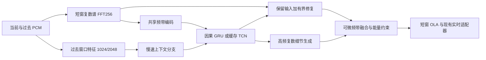

# 从局部微调转向结构重建：音频恢复调研与实验决策

调研日期：2026-10-11。代码审计基点：`1d3ca10c3faf2fb4a68c2ea158d6849a9357c31e`。
本文保留最初研究结论和实验设计。批准后的 P0/P1 实施状态、六次小样本训练和成本
记录见[第一阶段结果](causal-prototypes-20261011.md)；P2 全库对照尚未启动。
本文补充[前次架构调研](architecture-research-20261011.md)，重新评估其后几轮实验的含义。

建议把下一轮主要预算投入**重新训练的联合复数频谱因果主干**，随后分别验证
长历史特征、感知纹理训练和可学习 DSP。现有证据支持改变实验路线，尚不能证明
这些设计一定成功，也不能把不同论文的数据集成绩排列成适用于 SoundEx 的 SOTA 榜。

## 已确认的瓶颈与尚未证实的解释

| 审计发现 | 证据 | 可以得出的结论 |
|---|---|---|
| 主干几乎不建模时间 | [generator.py](../training/models/generator.py) 的主体卷积核是 `(1, k)`；C9 输入先取当前帧进入主干，历史交给 refiner | 后加历史分支不等于整个网络已经具备充分的时序建模 |
| 新表示只覆盖小分支 | [spectral_refiner.py](../training/models/spectral_refiner.py) 使用 gain-shape 特征，但父模型仍吃 raw phase；修正限制为 ±12 dB / ±0.5 rad | 之前的结果不能否定端到端复数表示，也不能视为 Apollo 或 AP-BWE 的完整复现 |
| 相位是实测弱项 | [相位诊断](phase-reconstruction-20261011.md)：音乐参考功率加权相位误差，输入 0.534109，模型 0.975867，零最好 | 值得联合重建相位与幅度；但全频复制输入相位曾使实际 HF 谱收敛退步，不能直接删掉相位预测 |
| 时间分支学到的作用很弱 | [V7 诊断](multires-reconstruction-20261011.md)：替换历史后最大幅度变化约 0.00128 dB；短程、低学习率续训，继承父模型并冻结 BN | 这是当前训练方案的负结果，不能判定过去信息对音乐修复没有价值 |
| 当前判别器不评价复数波形纹理 | [discriminator.py](../training/models/discriminator.py) 对幅度特征做频率池化；[train.py](../training/train.py) 只传 `[:, :1]`；近期续训关闭 GAN，V7 明确拒绝非零 GAN 权重 | 重新打开旧 GAN 开关不等于实现多分辨率复数/波形感知训练 |
| 训练代理与实际 DSP 有差异 | `batch_deployment_geometry` 使用 manifest cutoff；部署使用在线检测器和递推状态；[增益拟合](gain-calibration-20261011.md)改善回归却损害实际恢复 | 需要对准最终输出训练；仅预测正确能量比例还不够 |
| 音乐有效高频覆盖有缺口 | [数据复核](goal-refinement-20261011.md)：253 首训练音乐中 171 首整曲 16 kHz 以上功率占比低于 1e-4；开发/留出曲风覆盖不全 | 应统计片段内、相对具体 codec 截止频率的有效训练时长；该统计不证明素材伪无损，也不是删除音乐的理由 |

目前最好的相位组合在历史留出音乐上，相比压缩直通减少了高频能量误差，
但 flux 误差仍增加约 0.203，SI-SDR 下降约 1.019 dB；见[完整结果](phase-reconstruction-20261011.md)。
因此我们仍在“补充高频”和“保留原有波形”之间付出明显代价，不能把 loss 的小幅下降当成目标完成。

另一个待验证的解释是监督目标间的冲突：若缺失细节无法由低频唯一确定，直接最小化
复数均方误差趋向条件均值，不同可能相位会相互抵消。这是统计上的机制解释，
**不是已定位本项目欠填充的唯一原因**。正确做法是区分可预测谐波、残留相位和不确定纹理，
用消融验证重建与感知目标的配合，而不是去掉波形约束或用噪声填满频谱。

## 相关方法通常怎样做

以下链接为论文或作者实现；数值是相应作者配置，未在 SoundEx 复现。
特别区分压缩音乐修复、理想低通后的带宽延展和语音降噪，它们的输入信息与目标不同。

| 方法及一手资料 | 核心方法 | 对本项目的价值与限制 |
|---|---|---|
| [Apollo，2024](https://arxiv.org/html/2409.08514v1) | 压缩音乐；分频带归一化复数表示、频带 Roformer、时间 TCN、复数输出和 GAN | 最接近我们的任务；16.54M 参数、20 ms 窗 / 10 ms hop 不能直接搬入。表中 53.23 ms 是 GPU 处理一秒音频耗时 |
| [AERO，2023](https://arxiv.org/abs/2211.12232v2) | 复数频谱 U-Net，时频重建、对抗和特征匹配；同时研究语音与音乐 | 支持联合幅相和感知训练；其论文质量成绩不构成我们的低延迟证明 |
| [AP-BWE，2024](https://arxiv.org/html/2401.06387v2) | 交互的幅度/相位 ConvNeXt 分支；相位由两通道经 atan2 得到；相位差分及波形/频谱判别器 | 有助于修正“直接回归绝对角度”的设计。主要是语音 BWE，CPU 倍实时不等于逐 hop 延迟 |
| [DeepFilterNet](https://arxiv.org/abs/2110.05588)、[官方实现](https://github.com/Rikorose/DeepFilterNet) | ERB 包络增益与复数多帧滤波；有 Rust 和流式集成 | 借鉴低成本编码、滤波和状态工程；同频线性滤波不能从全零历史凭空产生缺失频带 |
| [GTCRN，官方实现](https://github.com/Xiaobin-Rong/gtcrn) | 分组时序卷积/循环网络，ERB 压缩，显式流式版本 | 官方更新口径为 48.2K 参数 / 33 MMAC/s，包含不可学习 ERB 参数；是语音降噪成绩，不能外推音乐补全 |
| [UL-UNAS，官方实现](https://github.com/Xiaobin-Rong/ul-unas) | 超轻语音增强与流式实现 | 用于参考计算和导出工程；需要额外的跨频带生成能力 |
| [超低延迟增强对照研究，2024](https://arxiv.org/html/2409.10358v1) | 在同一语音任务比较非对称窗、可学习变换、预测、模型容量及 Mamba | 强基线上长分析/短合成窗不总占优；Mamba 在短延迟下退步；相同网络减小 hop 会增加每秒计算。应做匹配实验 |
| [AudioSR，2023](https://arxiv.org/abs/2309.07314) | 面向多类音频的潜空间扩散超分辨率 | 提供生成式先验的参考，不是已经满足 CPU 小块流式预算的候选 |
| [FLowHigh，2025](https://arxiv.org/html/2501.04926v1) | 单步 flow，mel Transformer 后接 BigVGAN；保留输入低频 | 向量场网络已达 35.4M，STFT2048/hop480，另有 vocoder；VCTK 低通上采样成绩不能证明压缩音乐效果 |
| [FlashSR，2025](https://arxiv.org/abs/2501.10807) | 扩散蒸馏为单步，配合超分辨率 vocoder | 可借鉴离线教师到小学生的思路；单步不等于小模型或低缓冲。这里指 Im/Nam 论文，不是同名 HiERspeech++ 项目 |
| [UniverSR，ICASSP 2026](https://arxiv.org/html/2510.00771v2) | 在复数 STFT 上做 flow，去掉独立 vocoder | 说明表示和合成路径本身值得改变；57M 参数、1024 点窗仍远超当前结构预算 |
| [HP-codecX，2026-09 修订](https://arxiv.org/html/2511.21580v2) | 谐波/打击乐解耦 codec，再预测缺失的高频 token | 借鉴按音乐成分分解表征；不能据此声称 token 系统达到 <10 ms。此次未建立其逐块延迟和完整资源证据 |
| [DDSP，作者介绍](https://magenta.tensorflow.org/ddsp) | 网络控制谐波合成、滤波噪声等可微 DSP | 将已知声学结构交给 DSP 是另一条路线；基础音高模型不直接覆盖复杂混音 |
| [音乐 DDSP 带宽延展，2023](https://arxiv.org/html/2311.07363v1) | 面向单音及复音音乐的谐波+噪声模型，高频多尺度谱监督 | 比普通激励器更值得试；论文配置为 16 kHz、1024 点分析窗、256 hop，包含音高估计，不能把小控制器参数当作全链成本 |
| [NovaSR，作者仓库](https://github.com/ysharma3501/NovaSR) | 极小 Conv1d 与 Snake 波形上采样器，16→48 kHz | 提醒我们小波形分支也可做对照；仓库的 A100 吞吐和待完善质量基准不能作为产品证据。不能先丢掉输入中已有的 8–16 kHz 再重建 |
| [Fast-ULCNet，2026](https://arxiv.org/abs/2601.14925) | FastGRNN 降低成本，并处理长音频隐藏状态漂移 | 提醒新循环模型必须做长时间状态测试；短片段高分不代表持续播放稳定 |

综合判断：值得吸收的是联合复数表示、真正的时间建模、条件化高频生成、训练期感知目标、
以及结构化 DSP。没有充分理由把“换 Transformer/Mamba/扩散”本身当作突破。
原模型的源码注释引用过一些上述论文，但其频率轴双分支加小 refiner 并不等价于完整实现。

## 首选设计：共享编码、真实时间状态、保真与生成分工

下面是本项目提出的待验证设计，不是上述任一论文的性能结论。

1. **完整更换表示和主干。** 输入用有能量尺度的 Re/Im 与 log magnitude，
   分频带编码后共享时间网络；额外传入采样率、频率位置及可从当前输入取得的带宽特征。
   不把真实 clean cutoff 或编码器不可获得信息作为运行时条件。
   当前帧可以保留 skip connection，但不能让历史只通过一个受限的小 head 起作用。
2. **先做两种因果主干对照。** 小型 GRU 和缓存膨胀 TCN，先比较同量级参数及实测成本。
   TCN 以约 64–128 hop 感受野起步；GRU 使用真实 burn-in 与截断反向传播，
   它的推理状态不是人为限制到同样帧数，因此历史消融须分别解释。
   第一阶段不加入时间 Transformer 或 Mamba，以减少同时变化的因素。
3. **快慢两种特征更新。** 快路径每 128 samples 处理瞬态；慢路径可每四 hop 更新一次
   过去窗口的谱形/谐波特征，其间使用最近可用状态，不等待下一次更新。
   1024/2048 点窗口在 48 kHz 覆盖约 21.3/42.7 ms；这是过去观察范围。
   先只作为条件特征，不改变合成窗。慢路径也必须有初始化、失效和 reset 规则。
4. **输出输入残差和缺失内容。** 可从 `Y = X + M_repair * R + M_missing * G` 起步：
   `R` 修复仍可观察的谱，`G` 是由全频带和历史条件生成的加性复数谱。
   `M` 为平滑、受约束的频率权重；第一组实验固定它，再单独测试学习权重。
   不能只有乘法 mask，否则真正为零的高频仍为零。DC/Nyquist 虚部与实数合成一致。
   这里的复数预测训练与此前失败的“对旧幅相模型输出直接做复数插值”是不同实验。
5. **DSP 参与最终目标。** 融合、增益、OLA 后的输出必须参与 loss；先保留冻结的
   MatchEdge 对照，再做联合学习的有界增益。对 detector 使用输入侧真实轨迹或
   经误差核查的因果代理，不让候选只适应静态 manifest cutoff。
   限幅前后的峰值与失真都要记录，避免模型依赖限幅器藏住过量能量。

长历史不要求读取未来，但增加计算、状态和启动预热。新主干需要新的显式 ONNX 状态契约，
不能冒充现有 C1/C9 图：每个物理声道保存自己的状态，提交与输出序号绑定；丢帧、reset、
换模型清空状态，静音/bypass 仍按协议推进。状态不完整时输出对齐 dry，不能移动播放时间轴。
归一化不得跨整段未来帧，离线训练与逐 hop 推理须数值一致。

## 模型规模不是唯一的资源指标

当前 shape-small 的解析计算量约为 **23,587,808 stereo MAC/hop**，在 48 kHz/128 hop
下约 **8.845 GMAC/s**，虽然只有 0.906M 参数。该估算沿用
[前次计算口径](architecture-research-20261011.md)，不是硬件指令计数。
大量共享卷积参数在多个频点重复计算，单纯增加宽度可能先消耗计算预算。

作为纸面成本检查，考虑极简 `387→192` 输入投影、两层 `GRU(192,192)`、`192→258` 输出：

| 项目 | 解析结果 |
|---|---:|
| 参数，含 Linear / PyTorch GRU 的偏置 | 568,962 |
| FP32 权重本体，不含 ONNX 图和运行时 | 2.170 MiB |
| stereo 矩阵 MAC/hop | 1,132,416 |
| 48 kHz 下 stereo 矩阵 MAC/s | 0.425G |
| 双声道、两层隐藏状态本体 | 3,072 bytes |

计算式：参数 `387*192+192 + 2*(3*192*(192+192)+6*192) + 192*258+258`；
stereo MAC 为 `2*(387*192 + 2*3*192*(192+192) + 192*258)`。
这不是已构建、导出或训练的候选；它没有频带细节分支、长窗特征、门控、DSP和算子调度成本。
**约 20.8 倍的矩阵 MAC 差不能写成 20.8 倍提速或音质不变。**
它只说明有必要重新分配计算，而不是默认“0.9M 太小，必须无限扩容”。

新结构初始设计范围为 0.6–1.5M 参数，仍以实测 <=2M / ONNX <8 MiB 为上限。
固定 256 samples 输出时间轴、<8 ms 目标、<10 ms 红线不变。第一阶段在当前 M5 Max
上以 stereo 完整 worker hop p99 <1.5 ms 作为研发余量目标，**不是已达成绩，也不改正式标准**。
逐 hop、节拍 miss、CPU/RSS、callback、长时状态与真实设备仍依[实时标准](realtime-standard.md)验收。
新模型的 CPU 占用不能从解析 MAC 直接推算。

## 第二个突破口：重建目标与纹理目标分阶段训练

当前 loss 已有复数、波形、多分辨率和瞬态等约束，问题不是简单“缺少 STFT loss”。
下一版要解决目标如何作用到新结构及最终输出，而非继续堆权重：

- **阶段一：有监督保真。** 新主干随机初始化，先做 clean identity、简单已知低通和
  单一真实 codec 的小样本拟合，再训练完整 codec 混合。保留输入频段的复数/波形约束，
  缺失频段的幅度、能量包络、谱形和参考瞬态差分约束；有效谐波处加强相位/相位增量。
  对重叠重建后的谱再分析，检查预测谱与可合成波形的一致性。
- **阶段二：感知纹理。** 从同一阶段一权重分叉，一支继续重建训练，一支增加
  多分辨率复数 STFT 判别器与特征匹配；音乐先以多频带纹理为重点，波形周期判别器另做消融。
  判别器只在训练时运行，不计入部署图。它仍会增加训练成本，并可能生成伪细节，必须盲听。
  使用 0.5–2 秒有效监督片段的起始范围，单独记录 burn-in 与裁剪支持区。
- **有区别的监督。** 弱能量随机相位不能与可靠相位等权；噪声状镲片和谐波乐器也不应只靠
  同一种逐点误差。参考音频可用于训练时的软音调性/瞬态标签，运行时分支只能依据输入。
  保留完整波形约束、静音/clean 控制和实际 flux 评价，防止用噪声换取更好 LSD。
- **模型与 DSP 一起评分。** 先校验新的可微代理，再分别输出 raw neural、冻结 DSP、
  联合训练 DSP 三种结果。不得用代理训练分数替代实际 Rust 音频选择。

与论文类似的“重建+感知”思路并不保证每个指标同时变好。对复杂随机高频不可能保证逐样本
逆转原始压缩；本项目仍以更接近参考及更好的听感为目标，不把人为制造明亮感定义为成功。

## 其他值得保留的结构路线

**谐波/瞬态/噪声的可微 DSP 分支，优先级二。** 在共享编码上分别生成有组织的谱线与
非周期细节，用参考包络/瞬态监督控制混合。先做直接谱残差对照，再试持续相位/滤波噪声合成。
随机激励若启用，须连续、可复现、带限并按声道管理；不能每块独立重置种子，不能把统一
F0 假设套到整首复音音乐。离线 HPSS 可以提供训练标签，但含未来帧的中值滤波不能进入实时输入。
现有 DSP 高频延展失败并未测试这种联合训练机制，也不能当作它已有效的证据。

**波形残差或可学习子带，优先级三。** 以小型因果 Conv1d 直接生成高频残差，保留原始音频
直通，再与复数路线比较。多速率/PQMF/MDCT 可以减小采样级计算，但必须把滤波器群延迟、
混叠、重建误差和 chunk 边界算在整链预算内。不能仅因网络 causal 就声称零延迟。
优先只改变分析特征；非对称分析/合成窗另做完美重建和冲激时延试验，不能与主干一起更换。

**大模型教师与蒸馏，后续条件路线。** 若轻量模型能拟合小样本却长期不能泛化，可在许可
明确的数据上训练较大的离线教师，用于表示/输出蒸馏。学生仍必须独立满足预算。
双向教师可能利用学生永远拿不到的未来信息，蒸馏目标须裁剪或重新设计；教师也可能产生错误细节。
目前不把大扩散、flow 或 codec-token 模型接到每 128 samples 的线上链路。

## 数据与评价需要同步改变

训练规模不能只按“300 首”计算。先按训练 split 统计有效秒数：相对每个 codec 截止频率的
高频活动、音调性、瞬态密度、曲风、来源和 stereo 类型。现有整曲 >16 kHz 统计只是一项线索。
在保持音乐/语音 253/254 与 1/254 总体比例的条件下，对音乐内部的高频活动和稀有模式做
有上限的分层抽样；保留 quiet/clean/自然低带宽控制。改变抽样必须另设消融，不能与新结构一起归因。

新实验分开报告理想低通、真实 MP3/AAC/Vorbis、配方外 codec；避免把只学会滤波器形状当成
反压缩。检查整体编码后的对齐、增益/极性及亚采样相位偏差；这是待核查项目，不表示现有配对已坏。
保留原采样率和真实同步 stereo；增强应联动声道，不能单独随机裁剪左右再拼成一对。

现有开发与历史留出已用于反复诊断。下一轮晋级需要新的、按录音及来源去重的独立音乐测试，
优先补齐缺失曲风；测试组应在新训练和候选选择前封存。任何已用于训练的音频不能重新标成独立测试。
如果合法新素材尚未准备好，只能报告开发结果和历史留出复核。

## 顺序、预算与停止规则

这些是待执行的研发阶段，不是已启动的后台队列。一次只进入下一项必要实验。

| 阶段 | 固定项与改变量 | 继续条件 / 失败后的处理 |
|---|---|---|
| P0：链路和可学习性诊断 | 冻结已有模型作基准；注入 clean oracle 的幅度/相位/复数谱；小训练集 identity 与有损拟合 | 先量化检测、增益和 OLA 自身造成的误差。oracle 也被破坏时先修链路；tiny-set 拟合失败时查表示、对齐、梯度，不直接长训 |
| P1：新主干工程探针 | 原创 GRU/TCN 两种原型；先无长窗、无 GAN；逐 hop state 接口 | PyTorch/ONNX/流式数值一致、参数/文件合格、完整 hop 留出实时余量；不合格先改结构 |
| P2：从头重建训练 | 旧主干从头训练作为控制；两种新主干；相同训练划分、目标、采样及优化搜索预算 | 起始每臂 4,096 updates / 2 seeds，记录有效音频秒数及耗时；学习曲线仍下降时允许等额延长。短试验只筛选，不宣称收敛上限 |
| P3：过去特征消融 | 固定胜出主干；无长窗 / past-only 1024/2048 特征；随后才比较抽样策略 | 真实历史相对重复当前帧/清零状态有稳定收益；历史敏感但质量不升也不算成功 |
| P4：纹理与 DSP 训练 | 同父权重分叉：重建控制 / 新判别器；学习增益作为下一独立分叉 | Rust 输出高频恢复与保真共同改善，并通过评分盲听；有嘶声、瞬态拖尾、声像飘移即保留失败证据、停止晋级 |
| P5：替代表示 | 仅当主路线暴露明确剩余瓶颈，再做 DDSP 分工或因果波形残差 | 与相同训练预算的直接复数残差比较，不能只用自然度/亮度单项获胜 |

P0 的 clean oracle 只用于诊断表示/部署链路的上限，不是可部署模型、训练输入或质量成绩。
P2 除了相同数据/updates，还须报告实际训练计算差异；GRU 与 TCN 的优化敏感性不能被单一
学习率掩盖。最多保留两条有前景路线延长训练，避免产生大量难以解释的小幅续训。

选择以实际 Rust 输出为准，逐录音 bootstrap，不把相同录音的 codec/采样率变体当独立样本。
第一轮研发目标是相对冻结候选让音乐 HF 谱收敛或 flux 至少改善 5%，同时高频能量、保留频段、
波形保真和立体声不出现实质退步；5% 是预设的研发筛选幅度，不是听觉阈值。
“CI 跨零”本身不能证明没有退步；最终非劣效界限须在候选评分前，结合量纲和听感协议登记。
还必须对比压缩直通和 DSP-only，不能只胜过较差的旧模型。

候选、模型哈希与选择规则固定后，才解封新测试；评分盲听必须有实际评分，不能把生成 WAV
当成听过。随后完成 mono/stereo、44.1/48 kHz、不规则 chunk、静音/脉冲、恢复/换模型和
每配置 30 分钟状态测试；物理设备和 x86_64 仍是独立验收项。

## 授权与本轮交付范围

本轮只阅读公开方法和作者实现说明，没有下载、导入外部权重、音频或模型源码。
例如 [Apollo 的 LICENSE](https://github.com/JusperLee/Apollo/blob/main/LICENSE)为 CC BY-SA 4.0，
不能仅因仓库公开就当作 Apache-2.0 资产重新发布。其他项目的代码许可也不自动等于其权重、
训练数据或教师输出的复用许可。后续采用本项目原创实现和已审查素材，新增依赖/教师另记来源。
MUSDB、Slakh 和有损 FMA 不因论文使用它们而重新进入我们的训练库。

本轮完成文献筛选、源码/实验审计、成本算式复核和实验顺序设计。没有新增训练结果、
模型 benchmark 或主观听感成绩，现有默认模型、DSP 策略和实时红线均未改变。
