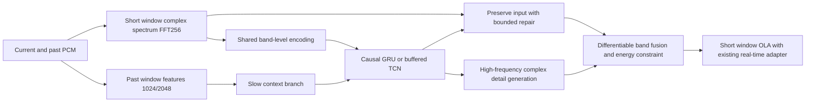

# From Local Fine-Tuning to Structural Reconstruction: Audio Restoration Survey and Experimental Decision

Historical protocol and results. See [research status](research.md) and the
[failure registry](failed-experiments.md) for current decisions; translation does
not turn reused validation into an independent test or update old acceptance limits.

Survey date: 2026-10-11. Code audit anchor: `1d3ca10c3faf2fb4a68c2ea158d6849a9357c31e`.
This document retains the original research conclusions and experimental design. Approved P0/P1 implementation statuses, six small-scale training runs, and cost records are documented in [First-Phase Results](causal-prototypes-20261011.md); P2 full-dataset cross-validation has not yet been initiated.
This document supplements the [prior architecture survey](architecture-research-20261011.md), re-evaluating the implications of subsequent experimental rounds.

We recommend reallocating the next round's primary budget to **retraining a joint complex-spectrum causal backbone**, followed by separate validation of long-horizon feature modeling, perceptual texture training, and learnable DSP. Current evidence supports a shift in experimental trajectory, though it cannot yet prove these designs will succeed. We also cannot rank performance across different papers' datasets as a valid benchmark for SoundEx SOTA.

## Confirmed Bottlenecks and Unverified Explanations

| Audit Finding | Evidence | Inferred Conclusion |
|---|---|---|
| Main backbone fails to model time | [generator.py](../training/models/generator.py) uses a main convolution kernel of `(1, k)`; C9 input passes current frame into the backbone, while history is passed to the refiner | Adding a history branch does not imply the network has achieved sufficient temporal modeling |
| New representation only covers narrow branches | [spectral_refiner.py](../training/models/spectral_refiner.py) uses gain-shape features, but the parent model still consumes raw phase; corrected to ±12 dB / ±0.5 rad | Previous results do not invalidate end-to-end complex representation, nor do they constitute a full realization of Apollo or AP-BWE |
| Phase reconstruction remains weak | [Phase Diagnosis](phase-reconstruction-20261011.md): Music-reference power-weighted phase error—input 0.534109, model 0.975867, zero is best | Joint reconstruction of phase and magnitude is warranted; however, full-frequency copying of input phase caused HF spectral convergence degradation and cannot be simply removed |
| Time branches learn minimal utility | [V7 Diagnosis](multires-reconstruction-20261011.md): Replacing history resulted in a maximum amplitude change of ~0.00128 dB; short-range, low-learning-rate continuation training, with frozen BN, inherited parent model | This is a negative outcome of current training—cannot conclude that historical information has no value in music restoration |
| Current discriminator does not evaluate complex waveform texture | [discriminator.py](../training/models/discriminator.py) performs frequency pooling on magnitude features; [train.py](../training/train.py) only passes `[:, :1]`; recent continuation training disabled GAN, V7 explicitly rejected non-zero GAN weights | Re-enabling the old GAN switch does not equate to achieving multi-resolution complex/waveform perceptual training |
| Training proxy differs from actual DSP | `batch_deployment_geometry` uses manifest cutoff; deployment uses online detector and recursive state; [Gain Calibration](gain-calibration-20261011.md) improved regression but harmed actual restoration | Final output training must align with actual deployment; correct energy proportion prediction alone is insufficient |
| Music lacks effective high-frequency coverage | [Data Recheck](goal-refinement-20261011.md): Among 253 training tracks, 171 have less than 1e-4 power above 16 kHz; development and held-out genre coverage is incomplete | Should quantify effective training time per fragment, relative to specific codec cutoff frequencies; this statistic does not prove the material is pseudo-lossless, nor should it justify removal of music |

The best phase combination on held-out music reduces high-frequency energy error compared to direct compression, but increases flux error by ~0.203 and degrades SI-SDR by ~1.019 dB; see [full results](phase-reconstruction-20261011.md).
Thus, we continue to pay a significant cost between "supplementing high frequencies" and "preserving original waveform"—a small loss reduction cannot be considered a successful outcome.

Another under-validated hypothesis is the conflict between supervision objectives: if fine details cannot be uniquely determined by low frequencies, minimizing complex MSE tends toward conditional mean, where different possible phases cancel out. This is a statistical mechanism, **not the sole reason for underfilling in this project**. The correct approach is to distinguish between predictable harmonics, residual phases, and uncertain textures, and to validate reconstruction and perceptual objectives through ablation—rather than removing waveform constraints or filling in spectral gaps with noise.

## How Related Methods Typically Approach the Problem

The following links point to papers or author implementations; values are from the authors' configurations and have not been reproduced in SoundEx.
We specifically distinguish between compressed music restoration, bandwidth extension after ideal low-pass filtering, and speech denoising—each with different input and target characteristics.

| Method and Primary Source | Core Method | Value and Limitations for This Project |
|---|---|---|
| [Apollo，2024](https://arxiv.org/html/2409.08514v1) | Compressed music; band-wise normalization of complex spectrum, band Roformer, time TCN, complex output and GAN | Most closely aligned with our task; 16.54M parameters, 20ms window / 10ms hop cannot be directly ported. Table value of 53.23ms is GPU processing time per second of audio |
| [AERO，2023](https://arxiv.org/abs/2211.12232v2) | Complex-spectrum U-Net, time-frequency reconstruction, adversarial and feature matching; also studied speech and music | Supports joint amplitude-phase and perceptual training; paper quality does not constitute proof of low-latency performance |
| [AP-BWE，2024](https://arxiv.org/html/2401.06387v2) | Interactive magnitude/phase ConvNeXt branches; phase derived from two channels via atan2; phase difference and waveform/spectrum discriminators | Helps correct the design of "direct regression to absolute angles". Primarily a speech BWE; CPU real-time does not imply hop-by-hop latency |
| [DeepFilterNet](https://arxiv.org/abs/2110.05588), [Official Implementation](https://github.com/Rikorose/DeepFilterNet) | ERB envelope gain and complex multi-frame filtering; with Rust and streaming integration | Draws inspiration from low-cost encoding, filtering, and state engineering; linear filtering within a band cannot generate missing bands from zero history |
| [GTCRN, Official Implementation](https://github.com/Xiaobin-Rong/gtcrn) | Grouped temporal convolutions/cyclic networks, ERB compression, explicit streaming version | Official update states 48.2K parameters / 33 MMAC/s, including non-learnable ERB parameters; performance is speech denoising and not transferable to music restoration |
| [UL-UNAS, Official Implementation](https://github.com/Xiaobin-Rong/ul-unas) | Ultra-light speech enhancement and streaming implementation | Useful for reference computation and export engineering; requires additional cross-band generation capability |
| [Ultra-Low Latency Enhancement, 2024](https://arxiv.org/html/2409.10358v1) | Compared asymmetric windows, learnable transformations, prediction, model capacity, and Mamba in the same speech task | Long analysis/short synthesis windows do not always dominate; Mamba degrades under short latency; reducing hop size increases compute per second. A matched experiment is needed |
| [AudioSR，2023](https://arxiv.org/abs/2309.07314) | Latent-space diffusion super-resolution for multi-class audio | Provides a generative prior reference, not a candidate that meets CPU small-block streaming budget |
| [FLowHigh，2025](https://arxiv.org/html/2501.04926v1) | Single-step flow, mel Transformer followed by BigVGAN; retains low-frequency input | Vector field networks reach 35.4M, STFT2048/hop480, with additional vocoder; VCTK low-pass upscaling performance does not prove effectiveness on compressed music |
| [FlashSR，2025](https://arxiv.org/abs/2501.10807) | Diffusion distillation to single-step, paired with super-resolution vocoder | Can draw inspiration from offline teacher to student approach; single-step does not imply small model or low buffer. Refers to Im/Nam paper, not the HiERspeech++ project |
| [UniverSR，ICASSP 2026](https://arxiv.org/html/2510.00771v2) | Flow on complex STFT, no separate vocoder | Demonstrates that the representation and synthesis path itself merits redesign; 57M parameters, 1024-point window still far exceeds current structural budget |
| [HP-codecX, 2026-09 Revision](https://arxiv.org/html/2511.21580v2) | Harmonic/instrumental separation codec, then predict missing high-frequency tokens | Draws inspiration from music-component decomposition; cannot claim token systems achieve <10ms. No evidence of per-block latency or full resource validation established |
| [DDSP, Author Introduction](https://magenta.tensorflow.org/ddsp) | Network-controlled harmonic synthesis, noise filtering, etc., via differentiable DSP | Handing known acoustic structures to DSP is a separate path; base pitch model does not cover complex mixtures |
| [Music DDSP Bandwidth Extension, 2023](https://arxiv.org/html/2311.07363v1) | Harmonic + noise model for monophonic and polyphonic music, multi-scale spectral supervision at high frequencies | More promising than a generic exciter; paper configuration: 16kHz, 1024-point analysis window, 256 hop, includes pitch estimation; cannot treat small controller parameters as full chain cost |
| [NovaSR, Author Repository](https://github.com/ysharma3501/NovaSR) | Ultra-small Conv1d and Snake waveform up-sampler, 16→48kHz | Reminds us that small waveform branches can serve as baselines; A100 throughput and incomplete quality benchmarks in the repo cannot serve as product evidence. Cannot discard existing 8–16kHz input before reconstruction |
| [Fast-ULCNet，2026](https://arxiv.org/abs/2601.14925) | FastGRNN reduces cost and handles long-audio hidden state drift | Reminds new cyclic models to undergo long-duration state testing; high scores on short clips do not imply stable playback over time |

Overall assessment: Worth adopting are joint complex representations, true temporal modeling, conditional high-frequency generation, training-time perceptual objectives, and structured DSP. There is no compelling reason to treat "replacing Transformer/Mamba/diffusion" as a breakthrough.
The original model's source code comments referenced several of these papers, but its frequency-axis dual-branch with a small refiner does not equate to a full implementation.

## Preferred Design: Shared Encoding, Real-Time State, and Separation of Faithfulness and Generation

Below is the proposed design under evaluation, not a performance conclusion from any of the referenced papers.

1. **Completely replace the representation and backbone.** Input uses energy-scaled Re/Im and log magnitude, encoded per band with shared time network; additionally passes sample rate, frequency position, and bandwidth features derivable from current input.
   Do not treat real clean cutoff or encoder-obtainable information as runtime conditions.
   The current frame may retain a skip connection, but historical input should not pass through a single restricted small head.

2. **First compare two causal backbones.** Evaluate a small GRU and a buffered-expanded TCN, comparing parameter count and real-world cost.
   TCN starts with a receptive field of ~64–128 hops; GRU uses true burn-in and truncated backpropagation.
   Its inference state is not artificially capped to the same frame count—historical ablation must be explained separately.
   Phase one does not include time Transformers or Mamba to reduce confounding variables.

3. **Fast and slow feature updates.** Fast path processes transient events every 128 samples; slow path updates past window spectral/harmonic features every four hops, using the most recent available state, without waiting for the next update.
   A 1024/2048 window at 48kHz covers ~21.3/42.7ms—this is the observed past window.
   Start by using it as conditional features only, without altering the synthesis window.
   The slow path must also have initialization, failure, and reset rules.

4. **Output input residual and missing content.** Start from `Y = X + M_repair * R + M_missing * G`:
   `R` repairs observable spectrum, `G` is a generative additive complex spectrum from full-band and historical context.
   `M` is a smoothed, constrained frequency weight. First experiments fix `M`, then separately test learning `M`.
   Cannot rely solely on multiplicative masking—otherwise truly zero high frequencies remain zero.
   DC/Nyquist imaginary and real components must be consistent.
   This complex prediction training differs from the previous failed experiment of directly interpolating complex output from an old magnitude-phase model.

5. **DSP participation in final objective.** The fused, gain-adjusted, and OLA output must be included in the loss.
   First retain a frozen MatchEdge baseline, then perform joint training with bounded gain.
   For detector evaluation, use the true input trajectory or error-verified causal proxy—do not allow candidates to adapt only to static manifest cutoff.
   Peak and distortion metrics must be recorded before and after limiting—avoiding model dependency on clipping to hide excess energy.

Long history does not require reading the future, but adds computational, state, and warm-up overhead.
The new backbone requires explicit ONNX state contracts—not to pretend to replicate existing C1/C9 graphs.
Each physical channel maintains its own state, submitted and output with sequence number binding.
Frame loss, reset, or model change must clear state; silence/bypass still follows protocol.
When state is incomplete, output aligns to dry, and playback time is not shifted.
Normalization must not span future frames; offline training and per-hop inference must numerically match.

## Model Scale Is Not the Sole Resource Metric

Current shape-small parse compute is approximately **23,587,808 stereo MAC/hop**, or about **8.845 GMAC/s** at 48kHz/128 hop, despite only 0.906M parameters. This estimate follows the [previous calculation standard](architecture-research-20261011.md), not hardware instruction counts.
Shared convolution parameters are repeatedly computed across frequency bands—increasing width alone may consume compute budget prematurely.

As a paper-level cost check, consider a minimal `387→192` input projection, two layers of `GRU(192,192)`, and `192→258` output:

| Item | Parse Result |
|---|---:|
| Parameters, including Linear / PyTorch GRU bias | 568,962 |
| FP32 weights, excluding ONNX graph and runtime | 2.170 MiB |
| Stereo matrix MAC/hop | 1,132,416 |
| Stereo matrix MAC/s at 48kHz | 0.425G |
| Dual-channel, two hidden state bodies | 3,072 bytes |

Formula: parameters `387*192+192 + 2*(3*192*(192+192)+6*192) + 192*258+258`;
stereo MAC = `2*(387*192 + 2*3*192*(192+192) + 192*258)`.
This is not a built, exported, or trained candidate. It lacks per-band detail branches, long-window features, gating, DSP, and operator scheduling costs.
**A 20.8x difference in matrix MAC cannot be interpreted as 20.8x speedup or unchanged quality.**
It only confirms the need to reassign compute, not that "0.9M is too small and must be infinitely expanded."

New structure initial design range: 0.6–1.5M parameters, with a ceiling of ≤2M parameters and ONNX <8 MiB.
Fixed at 256-sample output window, <8ms target, <10ms hard limit.
First stage targets a hop-by-hop p99 latency <1.5ms on M5 Max—**this is a development margin, not a performance achievement, nor a change to official standards**.
Per-hop, beat miss, CPU/RSS, callback, and long-term state behavior remain subject to [real-time standard](realtime-standard.md) acceptance.
CPU usage of new models cannot be directly inferred from parse MAC.

## Second Breakthrough: Phased Training of Reconstruction and Texture Objectives

Current loss already includes complex, waveform, multi-resolution, and transient constraints—this is not a simple "missing STFT loss" issue.
The next version must solve how objectives act on the new structure and final output, not just add more weights:

- **Phase 1: Supervised Fidelity.** Randomly initialize the new backbone, first train on clean identity, simple known low-pass, and single real codec small-sample fitting, then full codec mix.
  Retain complex/waveform constraints on preserved input bands, and for missing bands, enforce magnitude, energy envelope, spectral shape, and transient difference constraints.
  Strengthen phase/phase increment in harmonically rich regions.
  Re-analyze reconstructed spectra to verify consistency with synthetically generated waveforms.

- **Phase 2: Perceptual Texture.** Split from the same Phase 1 weights: one branch continues reconstruction training, the other adds multi-resolution complex STFT discriminator and feature matching.
  Music prioritizes multi-band texture, with waveform periodicity discriminator tested separately.
  Discriminator runs only during training, not in deployment. It increases training cost and may generate pseudo-details—blind listening is required.
  Use 0.5–2 second effective supervision segments, record burn-in and crop support zones separately.

- **Distinguishable Supervision.** Weak energy random phases should not be weighted equally to reliable phases; noise-like cymbals and harmonic instruments should not rely solely on point-wise error.
  Reference audio may be used for soft tonal/instantaneous labeling during training, but runtime branches must rely only on input.
  Retain full waveform constraints, silence/clean controls, and actual flux evaluation—prevent using noise to gain better LSD.

- **Joint Model and DSP Evaluation.** First validate the new differentiable proxy, then output three versions: raw neural, frozen DSP, and jointly trained DSP.
  Do not substitute proxy training scores for actual Rust audio selection.

Like papers, the "reconstruction + perception" approach does not guarantee all metrics improve.
Complex random high frequencies cannot be guaranteed to reverse compression sample-by-sample.
This project still aims for closer alignment to reference and better listening quality—not defining success as artificially bright or "lively" output.

## Other Worth-Preserving Structural Paths

**Differentiable DSP branches for harmonics/instantaneous/noise, Priority 2.**
Generate organized spectral lines and non-periodic details on shared encoding, controlled by reference envelope/transient supervision.
Start with direct spectral residual comparison, then try continuous phase and noise filtering synthesis.
If random excitation is enabled, it must be continuous, reproducible, limited, and per-channel managed.
Do not independently reset seeds per block, nor assume a single F0 across all tracks.
Offline HPSS can provide training labels, but future-frame median filtering must not enter real-time input.
Current failure of high-frequency extension has not been tested under this joint training mechanism and cannot be taken as evidence of success.

**Waveform residual or learnable subband, Priority 3.**
Use a small causal Conv1d to directly generate high-frequency residuals, preserve direct audio path, and compare with complex route.
Multi-rate/PQMF/MDCT can reduce sample-level computation, but must include filter group delay, aliasing, reconstruction error, and chunk boundary costs in total chain budget.
Cannot claim zero latency simply because the network is causal.
Prioritize changing only analysis features; non-symmetric analysis/synthesis windows require perfect reconstruction and impulse delay tests—cannot be combined with backbone changes.

**Large-model teacher and distillation, future conditional path.**
If a lightweight model fits small samples but fails to generalize, a larger offline teacher can be trained on clearly permitted data for representation/output distillation.
The student must independently meet budget constraints.
Bidirectional teachers may exploit information unavailable to the student—distillation objectives must be clipped or redesigned; teachers may also introduce errors.
Currently, no large diffusion, flow, or codec-token model is connected to a per-128-sample streaming pipeline.

## Data and Evaluation Require Concurrent Updates

Training scale cannot be assessed solely by "300 tracks." First, count effective seconds per training split: relative to each codec's cutoff frequency, high-frequency activity, tonality, transient density, genre, source, and stereo type.
Current count of full tracks above 16kHz is only a hint.
Under the constraint of preserving overall music/voice ratio at 253/254 and 1/254, perform capped, stratified sampling of high-frequency activity and rare patterns within music; preserve quiet/clean/natural low-bandwidth control.
Any change in sampling must undergo ablation—cannot be attributed to new structure.

New experiments must separately report ideal low-pass, real MP3/AAC/Vorbis, and external codec performance; avoid treating only learned filter shapes as anti-compression.
Check overall post-encoding alignment, gain/polarity, and sub-sampling phase bias—these are pending verification, not evidence of current pairing failure.
Preserve original sample rate and true stereo sync; enhancement must be channel-aware, not independently cropped and recombined.

Existing development and historical held-out data have been used for repeated diagnosis.
Next round promotion requires new, source- and recording-de-duplicated independent music testing, prioritizing genre coverage gaps.
Test sets must be sealed before new training or candidate selection.
Any audio used in training cannot be re-labeled as independent test.

If new materials are not yet available, only development results and historical held-out recheck may be reported.

## Order, Budget, and Termination Rules

These represent the pending research phases, not active background queues. Only one experiment proceeds at a time.

| Phase | Fixed Elements and Changes | Continuation Conditions / Failure Handling |
|---|---|---|
| P0: Link and Learnability Diagnostics | Freeze existing model as baseline; inject clean oracle magnitude/phase/complex spectrum; small training set identity and lossy fitting | Quantify detection, gain, and OLA-induced errors. Oracle failure first fixes the link; tiny-set fitting failure triggers investigation of representation, alignment, and gradient—no direct long training |
| P1: New Backbone Engineering Probe | Original GRU/TCN prototypes; no long window, no GAN | PyTorch/ONNX/streaming numerical consistency, parameter/file validity, full hop real-time margin; fail if not met—first modify structure |
| P2: Full Reconstruction Training | Retrain old backbone as control; two new backbones; identical training split, objective, sampling, and optimization search budget | Start with 4,096 updates / 2 seeds per arm; record effective audio seconds and time; allow equal extension if learning curves continue to decline. Short trials only for screening, not claiming convergence ceiling |
| P3: Past Feature Ablation | Fixed winning backbone; no long window / past-only 1024/2048 features; then compare sampling strategies | Stable gain from relative history over current frame or zero state; history-sensitive but no quality gain does not constitute success |
| P4: Texture and DSP Training | Split from parent weights: reconstruction control / new discriminator; learn gain as next independent fork | Rust output shows improved high-frequency recovery and fidelity; blind listening required; retain failure evidence of hiss, transient tailing, or imaging drift; stop promotion if present |
| P5: Alternative Representations | Only if main path reveals clear bottleneck, then pursue DDSP division or causal waveform residual | Must compare against same-budget direct complex residual; cannot win only on naturalness or brightness |

P0 clean oracle is for diagnostic use only—only to validate representation and deployment chain limits, not for deployment, training input, or quality scores.
P2, in addition to identical data and updates, must report actual training compute differences; GRU and TCN sensitivity to optimization cannot be masked by a single learning rate.
At most, two promising paths may be extended—avoid producing excessive, hard-to-explain minor continuation runs.

Evaluation must be based on actual Rust output, bootstrapped per recording.
No independent sample variants (e.g., codec/sample rate variants) should be treated as separate.
First-round development goal: relative to a frozen candidate, achieve at least 5% improvement in HF spectral convergence or flux, while preserving high-frequency energy, preserved bands, waveform fidelity, and stereo integrity—no substantive degradation.
5% is a pre-set development filter, not an auditory threshold.
"CI crossing zero" does not prove no degradation; final non-inferiority boundary must be established before candidate scoring, with metric and listening protocol.
Must also compare against direct compression and DSP-only—cannot claim superiority over only a worse prior model.

Only after candidate, model hash, and selection rules are fixed may new testing be unlocked.
Blind listening scoring must involve actual human evaluation—not generating WAV files as "heard."
Then complete mono/stereo, 44.1/48kHz, irregular chunk, silence/pulse, recovery/model switch, and every 30 minutes of state testing.
Physical hardware and x86_64 remain independent acceptance criteria.

## Authorization and Scope of This Round

This round only reads public methods and author implementation notes—no external weights, audio, or model source code is downloaded or imported.
For example, [Apollo's LICENSE](https://github.com/JusperLee/Apollo/blob/main/LICENSE) is CC BY-SA 4.0, so its public availability does not imply it can be re-released under Apache-2.0.
Other project code licenses do not automatically transfer to reuse of weights, training data, or teacher outputs.
Future use of this project's original implementation and reviewed materials will require new dependency and teacher attribution.
MUSDB, Slakh, and lossy FMA are not re-added to our training corpus simply because they were used in a paper.

This round completes literature screening, source code/experiment audit, cost formula verification, and experimental sequence design.
No new training results, model benchmark, or subjective listening scores are added.
Existing default model, DSP strategy, and real-time hard limits remain unchanged.
